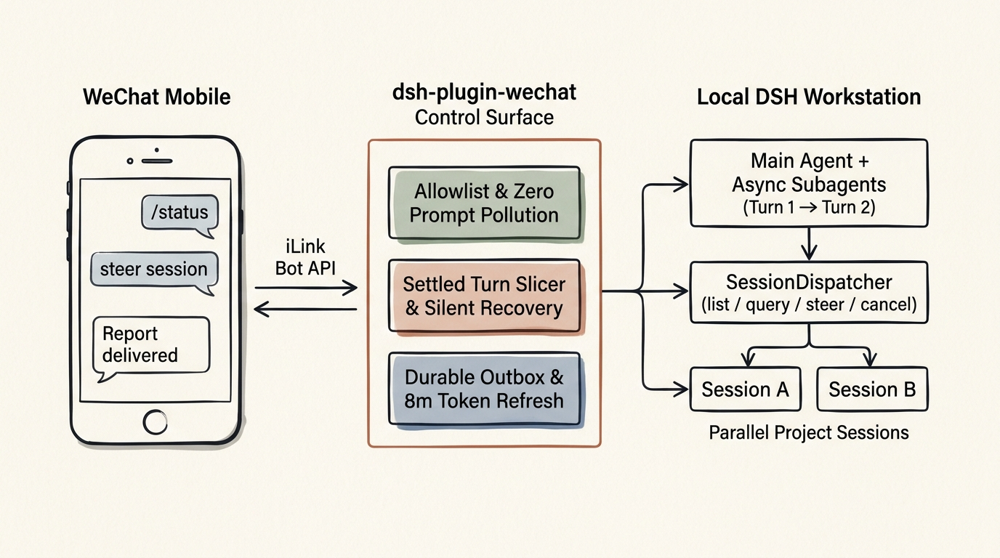

<div align="center">

# dsh-plugin-wechat · 微信远程控制面

**把你的个人微信，变成 DeepSeek Harness (DSH) 的生产级远程工程控制面。**

在手机微信里发一句话，唤醒并调度你本机正在运行的 DSH Agent —— 文字、图片、文件、语音（本地 ASR）双向互通，异步 Subagent 结果保序回推，支持跨项目平行会话调度。


[](LICENSE)

**简体中文** ｜ [English](README.en.md)


</div>



---

## 1. 定位与开源致谢 (Positioning & Acknowledgment)

本项目基于 **[panqing0313](https://github.com/panqing0313)** 开源的先驱项目 [`dsh-plugin-weixin`](https://github.com/panqing0313/dsh-plugin-weixin) 深度重构与演进。

首先向原作者 **panqing0313** 致以诚挚感谢：他率先跑通了基于腾讯官方 `iLink Bot API`（`@tencent-weixin/openclaw-weixin`）的免挂纯 Web 扫码通道，并构建了多账号独立长轮询、本地 Whisper 语音转写桥接与完整的多页签设置卡 UI，为 DSH 社区连接个人微信奠定了极其扎实的工程基石。

### 为什么要做这个演进版？（设计哲学的分野）

两个项目面向截然不同的核心场景：

- **上游原版（[`panqing0313/dsh-plugin-weixin`](https://github.com/panqing0313/dsh-plugin-weixin)）**：定位为**全功能陪伴型微信助手**，内置了丰富的长期情感记忆、好感度关系曲线、生活作息状态推断、模拟真人拆气泡延迟以及 11 套角色人设与内置表情包。
- **本仓库（[`xrzhai/dsh-plugin-wechat`](https://github.com/xrzhai/dsh-plugin-wechat)）**：定位为**面向重度工程、量化回测与投研工作流的生产级远程控制面（Engineering Control Surface）**。

在 DSH 0.2.2+ 的重度生产环境中，Agent 的日常不再是简单的“单轮闲聊问答”，而是**长达数十分钟的命令行执行、密集并发的异步 Subagent 派发、以及桌面端多个工程会话的并行推进**。为此，我们在保留原版优秀传输层与多模态能力的基础上，做了坚决的**“减法”**与硬核的**“加法”**：

| 维度 | 上游陪伴版 (`dsh-plugin-weixin`) | 工程控制面版 (`dsh-plugin-wechat`) | 解决的核心工程问题 |
| :--- | :--- | :--- | :--- |
| **每轮提示词纯净度** | 每轮自动前置注入 `<weixin_memory>` / `<weixin_life>` 等多块上下文 | **零 Prompt 污染（Zero Prompt Pollution）** | 剥离每轮隐式 XML 标签注入，100% 交由宿主 `AGENTS.md` 与原生前缀缓存 Compaction 接管，省 Token 且不干扰长链推理 |
| **Subagent 异步多回合回推** | 单游标读取，后一 Turn 直接覆盖前一 Turn | **`readSettledTurns` 按回合边界切片保序交付** | 解决主 Agent 汇总 Subagent 结论（Turn $N$）后，紧随其后的子代理退出通知（Turn $N+1$ `[SILENT]`）把真实结论吞没的顽疾 |
| **同回合末尾静默抢救** | 仅取 Turn 末尾文本，末尾 `[SILENT]` 导致整轮静默 | **`replyBeforeSilent` 有限状态机无损抢救** | 当 Step 1 已输出完整答复（`finish(stop)`），而子代理退出通过 `steer` 触发同 Turn 的 Step 2 输出 `[SILENT]` 时，安全救回 Step 1 正文 |
| **跨项目平行会话调度** | 微信仅能与自身绑定的单一会话线性对话 | **`SessionDispatcher` 显式授权跨会话调度** | 出门在外可通过微信调用 `session_list / query / dispatch`，对桌面端其他项目会话执行 `followup`、`steer` 纠偏或 `cancel` 中止 |
| **长代码块投递保真度** | 超过 1200 字的代码块转文件附件，上传失败即丢正文 | **调度结果强制 `richContent: false` 纯文本分段** | 确保跨会话调度的长代码与日志 100% 通过文本气泡完整送达手机，绝不因 CDN 媒体上传波动丢失正文 |
| **长任务 Token 过期与死信** | 超过 10 分钟后持过期 `context_token` 重试，进度提示堆积成死信 | **8 分钟窗口主动刷新 + `durable:false` 瞬态分流 + 自动剪枝** | 长耗时工具（>8m）回复前自动刷新凭证并降级无 token 通道；进度提示失败即弃不落盘，定时清理耗尽重试的死信 |
| **网关热启停与路径沙箱** | 修改总开关需重启或遗留旧轮询；基础文件校验 | **`Live Gateway Switch` 平滑排水 + `realpathSync` 软链沙箱** | 设置卡开关即刻热启停并等待在途回合完成（drain）；自动发文件与显式附件共用规范路径校验，严防符号链接越界与重复发送 |

---

## 2. 四大核心工程机制深剖 (Architecture Deep Dive)

### 2.1 零 Prompt 污染：把上下文控制权交还给 Harness
在长上下文推理（1M Context + 400k 自动 Prefix-Cache Compaction）场景下，网关层如果在每一轮 User Message 前动态拼接变化的记忆块、时间状态或好感度标签，不仅每轮额外消耗 Token，还会破坏模型对指令层级的注意力分布。
- `dsh-plugin-wechat` 默认移除了普通对话回合中的隐式 Prompt 注入与拟人化拆气泡延迟；
- 会话规范完全遵循工作区根目录下的 `AGENTS.md`（且设置卡内置了可视化 `AGENTS.md` 编辑器，已修复原版样式调用白屏问题并包裹 `ErrorBoundary`）。

### 2.2 异步 Subagent 连续回合切片与同回合静默抢救
在 DSH 0.2.2+ 的多智能体拓扑中，子代理（Subagent）的生命周期与主会话事件流存在两种典型的竞态窗口：
1. **跨回合吞没（Multi-Turn Overwrite）**：主 Agent 在 **Turn $N$** 汇总完所有 Subagent 的调研结果并生成长文报告；几百毫秒后，Subagent 进程彻底退出向宿主投递系统通知，触发 **Turn $N+1$**，主模型按规范回复 `[SILENT]`。我们在 [`src/session-reader.js`](src/session-reader.js) 中实现了 `readSettledTurns({ events, afterSeq })`，严格以 `turn/start` 至 `turn/end` 为边界切分所有已结算回合，在 `#pollSpontaneous()` 中逐轮保序下发实质内容，遇到 `[SILENT]` 仅推进游标而不覆盖前序成果。
2. **同回合末尾静默（Same-Turn Trailing Silent）**：一个 Turn 可包含多个 Step。当模型在 **Step 1** 已正常结束正式回复（无工具调用、`finish(stop)`），恰逢子代理退出通知通过 `steer` 进入同回合的 **Step 2** 且模型输出 `[SILENT]` 时，`replyBeforeSilent` 状态机会严格核验 Step 1 的起止边界、确认无未捕获异常与工具调用、且中间无真人新指令插入后，精准提取 Step 1 的正式答复出站（详见 [`docs/silent-reply-recovery.md`](docs/silent-reply-recovery.md)）。

### 2.3 显式授权的平行会话调度 (`SessionDispatcher`)
让你在手机微信上成为整台工作站的调度中枢（详见 [`docs/session-dispatcher.md`](docs/session-dispatcher.md)）：
- **三大原语工具**：向授权微信主会话注入 `session_list`（列出桌面端活跃/空闲会话）、`session_query`（只读查看目标会话最近事件与执行状态）、`session_dispatch`（向目标会话下发指令）。
- **三种控制动作**：
  - `followup`：目标会话空闲时追加新任务；
  - `steer`：目标会话正在跑长任务时，实时注入纠偏指令；
  - `cancel`：紧急中止目标会话当前正在执行的回合。
- **纵深防御沙箱**：
  - **默认关闭 & 双重白名单**：必须显式开启 `sessionDispatcherEnabled`，且同时匹配 `sessionDispatcherSenders`（发送者白名单）与 `sessionDispatcherTargets`（目标会话 ID 精确白名单，不支持通配符）；
  - **软链穿透只读守卫**：`readOnlyPaths` 与 `protectedSessions` 结合 `realpathSync` / Windows Junction 解析，严防通过目录别名对受保护工作区发起写操作；
  - **防递归与防死锁**：代码级核验真实执行 Agent 身份，严禁 Subagent 继承调度工具，严禁微信控制会话自调用或互调；
  - **同步等待 + 异步追踪双模交付**：短任务直接同步返回结果；长任务超时自动转为后台追踪（绑定唯一 `dispatchId` 与目标 Turn），完成后以纯文本分段精准回推给原发起微信。

### 2.4 出站队列自愈与 8 分钟 Token 生命周期治理
微信 iLink 协议下发的 `context_token` 仅在收到消息后约 **10 分钟内**有效，而工程任务（跑全量测试、编译、深度检索）极易超过该窗口：
- **8 分钟安全阈值切换（`sendToken()`）**：当回合耗时超过 8 分钟安全窗口，网关在发送回复前自动刷新微信 typing ticket，并切换至无 token 兜底路径，避免拿着过期 token 硬发报错；
- **瞬态通知与持久回复物理隔离**：形如 `（正在执行 pwsh 14m...）` 的进度提示与超时通知一律标记为 `durable: false`，投递失败仅记日志并立即丢弃，绝不写入持久队列；
- **死信自动剥离与剪枝（`prune`）**：持久出站队列 `outbox.flush` 遇到过期 token 条目时，先自动剥离失效 token 走纯文本重试；每轮 flush 前自动清除“重试耗尽且凭证已死”的陈年死信，彻底根治队列阻塞。

---

## 3. 30 秒极速上手 (Quick Start)

### 方式 A：从源码安装到 DSH Profile（推荐）

```bash
git clone https://github.com/xrzhai/dsh-plugin-wechat.git
cd dsh-plugin-wechat
pnpm install
node bin/install.mjs --profile desktop
```

### 方式 B：开发者本机 `link:` 软链挂载（改代码即刻同步）

在 `~/.dsh/profiles/desktop/package.json` 中指向本仓库路径：

```json
{
  "dependencies": {
    "dsh-plugin-wechat": "link:D:/Projects/dsh-plugin-wechat"
  },
  "dsh": {
    "profile": {
      "bundles": [
        "@deepseek-ai/dsh-base",
        "@deepseek-ai/dsh-web-app",
        "dsh-plugin-wechat"
      ]
    }
  }
}
```

> **无感升级说明**：本插件在底层的 Cordis 实例 ID 保持为 `dsh-weixin`，本机凭证与状态目录保持为 `~/.dsh/weixin/`（权限 `0600`）。因此从旧版 `dsh-plugin-weixin` 切换到 `dsh-plugin-wechat` 时，**已绑定的微信号、白名单、历史会话与设置项 100% 原地保留，无需重新扫码**。

### 扫码登录与首联系人自动授权

1. 启动或重启 DSH，打开 **「设置 → 插件 → 微信BOT」**（或直接点击左侧栏的 **「微信BOT」** 图标），点击 **扫码登录微信**（终端也可运行 `npm run login`），无需重启宿主即可拉起长轮询。
2. **默认拒绝所有人（Deny-by-default）**：初始 `allowedSenders` 为空。新绑定账号收到的**第一条微信消息**会自动将该发信人登记为账号主人并放行；此后任何陌生人发信均被静默拦截（可在设置卡「陌生人」列表中一键加白）。
3. **环境体检**：
   ```bash
   npm run onboard          # 检查上手就绪状态（退出码 0 = 全部就绪）
   npm run doctor           # 13 项深度体检（账号/白名单/实例锁/队列积压/宿主兼容性）
   npm run doctor -- --fix  # 自动修复目录缺失、权限过宽与陈旧临时文件
   ```

---

## 4. 微信端交互与命令速查 (Commands & Controls)

所有斜杠指令均由网关在本地直接拦截响应，**不消耗任何模型 Token**（仅 `/compact` 透传给宿主执行上下文压缩）；未知斜杠指令也会被安全拦截并提示，防止手误发给模型白花钱。

### 4.1 会话与执行控制

| 微信发送指令 | 功能说明 |
| :--- | :--- |
| `/new [标题]` | 开启一条全新的 DSH 会话线（旧会话完整保留在宿主中，随时可切回） |
| `/list` 或 `/sessions` | 列出当前微信账号下的所有历史会话线及序号 |
| `/use <序号>` | 切换到指定序号的历史会话线继续工作 |
| `/cancel` 或 `/取消` | **紧急中断**：在长任务运行期间随时发送，立即中止当前正在执行的 Agent 回合 |
| `/compact` 或 `/压缩` | 透传触发 DSH 宿主原生的上下文无损压缩（Compaction） |
| `/status` | 查看当前账号连接状态、活跃会话线、白名单来源与待发提醒 |
| `/diag` / `/diag export` | 网关实时自检报告 / 导出一份脱敏的排障体检包 |
| `/outbox` / `/outbox retry` | 查看出站待重发队列 / 立即触发队列重发 |
| `/send <本地文件路径>` | 将 `mediaDirs` 白名单目录内的指定文件直接发回手机微信 |
| `/help` 或 `/帮助` | 查看当前支持的所有快捷指令清单 |

### 4.2 在微信里跨会话调度桌面项目（开启 `sessionDispatcherEnabled` 后）

当你把自己的微信 ID 填入 `sessionDispatcherSenders`，并把桌面端正在跑的工程会话 ID 填入 `sessionDispatcherTargets` 后，直接在微信里用自然语言对主 Agent 说：
- *“帮我看看现在桌面上有哪几个项目会话在跑？”*（自动调用 `session_list`）
- *“看一下量化回测那个会话现在跑到哪一步了？”*（自动调用 `session_query`）
- *“给回测会话发个 steer：先别跑全市场，只跑纳指 100 成分股。”*（自动调用 `session_dispatch` · `action: "steer"`）
- *“把刚才卡住的那个爬虫会话 cancel 掉。”*（自动调用 `session_dispatch` · `action: "cancel"`）

---

## 5. 多模态与核心配置速查 (Multimodal & Configuration)

### 5.1 双向多模态能力
- **入站（手机 → DSH）**：
  - **文字与链接**：支持引用回复解析；开启 `readLinks` 时自动并发抓取消息中的网页正文供 Agent 参考；
  - **语音（SILK → WAV → 本地 ASR）**：内置常驻 Python ASR 桥（[`bin/asr-bridge.py`](bin/asr-bridge.py)，支持 `faster-whisper` / `whisper.cpp` / `funasr`），热调用约 300ms 转成文字送入模型；未配 ASR 时自动降级保存音频文件；
  - **图片、文档与视频**：图片与文件自动解密落盘至 `~/.dsh/weixin/inbox/`；支持 PDF/Office/纯文本自动抽取正文（`documentExtract`），收到视频自动调用本机 `ffmpeg` 抽取 3 帧静图（`videoFrames`）。
- **出站（DSH → 手机）**：
  - Agent 回复中引用的本地图片/文件（``）或本回合在工作区新生成的文件，经 `resolveAllowedPath`（含 `realpathSync` 符号链接越界拦截与规范路径去重）校验通过后，自动上传微信 CDN 发回手机。

### 5.2 关键配置项（`~/.dsh/weixin/config.json` 或设置卡 UI）

设置卡 UI 的 **「配置项」** 页签支持全文搜索，并标注了每项配置的生效方式（`保存即生效` / `重启后生效`）：

| 配置字段 | 默认值 | 说明 |
| :--- | :--- | :--- |
| `enabled` | `true` | 网关总开关（支持 `Live Gateway Switch` 保存即刻热启停并平滑排水） |
| `cwd` | `""` | 微信新建会话的默认工作目录（自动加载该目录下的 `AGENTS.md`） |
| `allowedSenders` | `[]` | 允许驱动 Agent 的微信用户 ID 白名单（默认空 = 拒绝所有人，首条消息自动登记主人） |
| `sessionDispatcherEnabled` | `false` | 是否启用跨项目平行会话调度工具（`session_list / query / dispatch`） |
| `sessionDispatcherSenders` | `[]` | 允许使用平行会话调度的微信发送者 ID 白名单 |
| `sessionDispatcherTargets` | `[]` | 允许被查询或调度的宿主目标 Session ID 精确白名单 |
| `protectedSessions` | `[]` | 仅允许只读查询、禁止 `followup/steer/cancel` 的受保护 Session ID |
| `readOnlyPaths` | `[]` | 平行会话调度的只读工作区根目录列表（自动识别子目录与软链/Junction 别名） |
| `busyMessageMode` | `"steer"` | 当 Agent 正在执行任务时收到你发来的新微信：`steer`（实时注入当前回合）或 `queue`（排队等下回合） |
| `progressAfterMs` | `45000` | 回合执行超过该毫秒数后，向微信发送一条瞬态进度提示（`durable: false`） |
| `maxTurnWaitMs` | `1200000` | 单回合最长等待时间（默认 20 分钟），超时后自动转入 `onLateReply` 后台完成即推 |
| `sendIntervalMs` | `1200` | 出站分片消息最小发送间隔（毫秒），防止高频发送触发微信端风控限制 |

---

## 6. 仓库结构与验证测试 (Repository Layout & Testing)

```text
src/
├── index.js                     # 插件主入口：Cordis 生命周期、入站管线与热启停编排
├── agent-bridge.js              # 微信会话 ↔ DSH Agent 会话桥接、#pollSpontaneous 多回合保序交付
├── session-reader.js            # 事件流解析：readSettledTurns 回合切片 & replyBeforeSilent 状态机抢救
├── session-dispatcher.js        # 平行会话调度核心：权限守卫、软链沙箱与 followup/steer/cancel 派发
├── session-dispatch-reader.js   # 被调度会话的只读快照与完成态追踪
├── session-host.js              # 宿主 Session / Agent 服务契约适配层
├── gateway-control.js           # Live Gateway Switch 实时热启停与在途回合平滑排水
├── outbound.js                  # 出站分片、代码块处理与产出文件自动投递
├── client.js / client.card.js   # DSH 设置页与左侧栏 React 管理面板（含 AGENTS.md 编辑器）
├── transport/ilink.js           # 微信 iLink 长轮询、8 分钟 Token 刷新与媒体收发
├── media/                       # 入站媒体解密、ASR 语音转写桥、OCR 与出站路径安全校验
├── message/                     # 出站队列 (outbox)、去重、分段、斜杠指令与诊断报告
└── security/allowlist.js        # 默认拒绝的账号级/全局双层白名单
vendor/openclaw-weixin/          # 腾讯官方 @tencent-weixin/openclaw-weixin (MIT) 纯净传输层副本
test/                            # 148 项全隔离单元与集成测试（零真实网络请求、隔离宿主状态）
```

运行测试套件（测试通过 `test/isolate-host-state.mjs` 自动隔离本机 `~/.dsh` 真实凭证并阻断外网请求）：

```bash
npm test                     # 运行全部 148 项单元与集成回归测试
npm run test:host-contract   # 验证与当前已安装 DSH Peer 依赖的宿主接口契约
npm run check                # 代码静态检查与依赖核验
```

### 延伸设计文档
- [平行会话调度架构与安全边界 (`docs/session-dispatcher.md`)](docs/session-dispatcher.md)
- [同回合末尾静默回复抢救契约 (`docs/silent-reply-recovery.md`)](docs/silent-reply-recovery.md)
- [队列并发、附件沙箱与热启停验收 (`docs/validation-issues-23-25.md`)](docs/validation-issues-23-25.md)
- [整体消息链路架构 (`docs/architecture.md`)](docs/architecture.md) · [安全威胁模型 (`docs/security.md`)](docs/security.md)
- [第三方开源声明 (`THIRD-PARTY-NOTICES.md`)](THIRD-PARTY-NOTICES.md) · [版本演进记录 (`CHANGELOG.md`)](CHANGELOG.md)

## License

[MIT License](LICENSE) © 2026 panqing0313, xrzhai (mine), and contributors. Transport layer vendored from [`@tencent-weixin/openclaw-weixin`](https://github.com/Tencent/openclaw-weixin) (MIT © 2026 Tencent).
