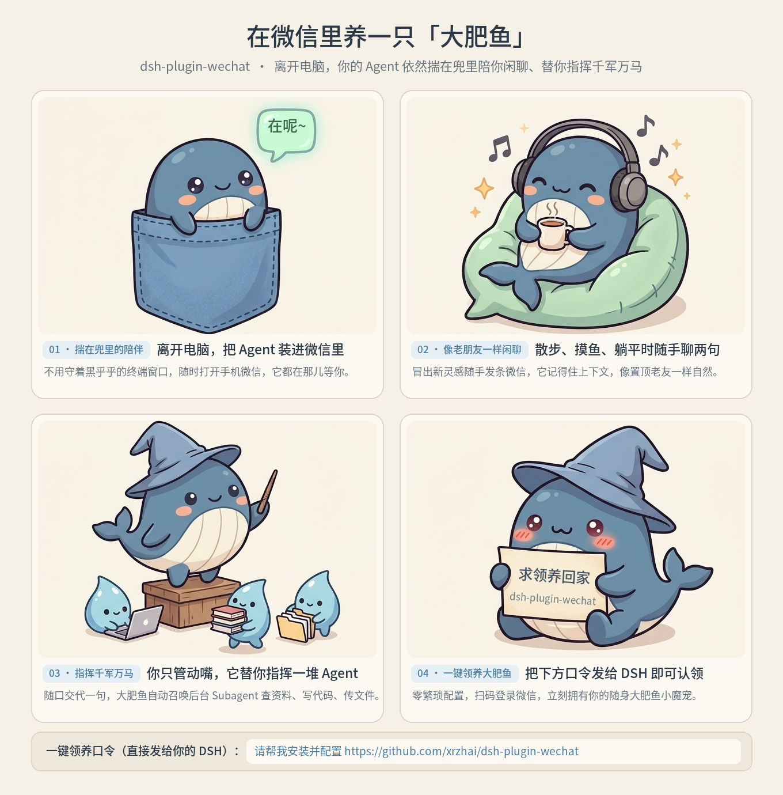

<div align="center">


# dsh-plugin-wechat

**在微信里养一只「大肥鱼」🐳 —— 离开电脑，你的 DeepSeek Harness 依然揣在兜里陪你闲聊、替你指挥千军万马**

[**English**](README.en.md) · [**MIT License**](LICENSE)

<br />



</div>

离开电脑时，直接用手机微信跟电脑上的 **DeepSeek Harness（DSH）** 像老朋友一样闲聊、派活、指挥后台 Agent：

- **揣在兜里随时陪聊**：散步、摸鱼、躺平时冒出新念头，不用守着电脑黑框，打开微信就能接着上下文随手聊两句。
- **谈笑间指挥一堆 Agent 干重活**：遇到费时间的活，你只管在微信里动嘴交代，大肥鱼会在电脑后台召唤子智能体（Subagents）并行查资料、写代码、改文档；跑完出结果自动推回你微信，需要电脑里的文件说句话就能直接发给你。
- **遥控电脑上的其他 DSH 会话**：在外面想看电脑上另一个窗口的进度，直接问“帮我看看写周报的那个会话跑到哪了？”、“让它把报错修一下”或“先停一下”。扫码认主后默认就能用，不用手抄会话 ID，也不用折腾各种白名单。

---

## 一、一分钟安装

打开电脑上的 DSH，直接把下面这句话发给它，让它自己装好：

```text
请帮我安装这个微信插件，按 README 的 Agent 安装指南执行：https://github.com/xrzhai/dsh-plugin-wechat
```

安装完成后，**完整退出并重新打开一次 DSH**。

---

## 二、扫码绑定微信

1. 点开 DSH 左侧栏的 **「大肥鱼 🐳」**（或打开「设置 → 大肥鱼」），在 **「微信账号」** 页点击 **「扫码登录微信」**，用手机微信扫一下。
2. 扫完码后，用你自己的微信给它发一句“你好”或 `/status`。插件会自动把第一个发消息的你登记为主人，别人发消息它不会理。
3. **顺手调教（可选）**：
   - 想改助理的称呼、说话风格或日常习惯，去 **「人设」** 页直接改；
   - 想指定它平时默认在哪个代码库或笔记目录干活，去 **「高级 → 基本设置」** 选一下默认工作文件夹。

---

## 三、在微信里怎么用

平时直接像跟同事发微信一样说人话就行：

- **查电脑上的其他任务**：“帮我列出最近的 DSH 会话，找一下写周报的那个。”
- **跨会话指挥**：“看看那个会话报错没有”、“让它把测试也补上”、“让那个正在跑的会话先停下来”。
- **拿电脑里的文件**：“把 `D:\Projects\report.pdf` 发给我”。

如果只想把微信当纯聊天窗口、不希望它碰电脑上的其他会话，去 **「高级 → 远程查看与管理 DSH 会话」** 把开关关掉即可。更细的目录与权限说明见[跨会话调度说明](docs/session-dispatcher.md)与[安全说明](docs/security.md)。

### 常用微信口令

下面的口令由插件直接秒回，**不消耗模型 Token**（注：`/list` 看的是当前微信聊天里建的话题；要看桌面上的其他 DSH 会话，直接用自然语言问它）：

| 你在微信里发 | 它的作用 |
| :--- | :--- |
| `/new` 或 `/new 写周报` | **开个新话题**（之前的聊天记录还留着，随时能切回来） |
| `/list` | **看微信话题列表**，会列出编号 `1, 2, 3...` |
| `/use 2` | **切回第 2 个话题**接着聊 |
| `/cancel` 或 `/取消` | **停掉当前正在生成的回复** |
| `/compact` 或 `/压缩` | 聊太久上下文满了，发这句让它自动压缩瘦身 |
| `/send 文件路径` | 直接把电脑上的某个文件发到你微信里 |
| `/status` | 看看当前连没连上、正在哪个话题里 |
| `/outbox` 或 `/outbox retry` | 看看有没有因网络波动暂存的回复，或手动补发 |
| `/clear` | 清空微信侧的话题列表（DSH 里的历史记录仍保留） |
| `/help` 或 `/帮助` | 忘了口令时调出小抄菜单 |

---

## 四、常见问题

- **刚装完连不上 / 提示登录过期？**
  安装或升级插件后，记得完整退出并重新打开一次 DSH；如果隔太久微信登录过期了，去「微信账号」重新扫个码就行。
- **笔记本合盖后收不到微信回复？**
  电脑休眠时网络和进程会暂停，掀开盖子唤醒后它会自动重连。
- **怎么更新到最新版？**
  直接对电脑上的 DSH 说：“帮我把微信插件更新到最新版”，更新完重启一下 DSH 即可。

---

## 五、Agent 安装指南（给 DSH 自己看的）

请将仓库克隆到固定目录（DSH 会直接链接该目录）。需要 Git、Node ≥ 22.13.0 和 pnpm；macOS 终端若找不到 `node` 或 `pnpm`，请使用 DSH 内置运行时（`~/.dsh/dsh-runtimes/...`）。将下方的 `desktop` 替换为用户实际的 profile 名称：

```sh
git clone https://github.com/xrzhai/dsh-plugin-wechat.git
cd dsh-plugin-wechat
pnpm install
node bin/install.mjs --profile desktop
npm run doctor -- --offline
```

- **升级**：在仓库目录执行 `git pull`，再跑一遍 `pnpm install`、`node bin/install.mjs --profile desktop` 与 `npm run doctor -- --offline`，最后提醒用户完整重启 DSH。
- **卸载**：执行 `node bin/install.mjs --profile desktop --uninstall`（本地凭据与历史会话默认保留在 `~/.dsh/weixin/`）。

---

## 六、致谢与协议

本项目基于 [panqing0313/dsh-plugin-weixin](https://github.com/panqing0313/dsh-plugin-weixin) 与 [Tencent/openclaw-weixin](https://github.com/Tencent/openclaw-weixin) 构建，采用 [MIT License](LICENSE) 开源。
